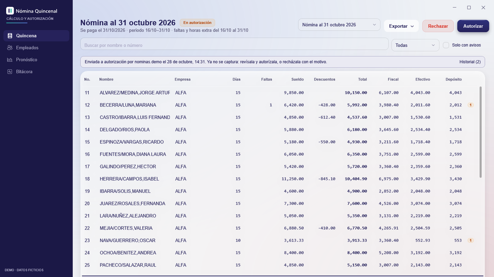
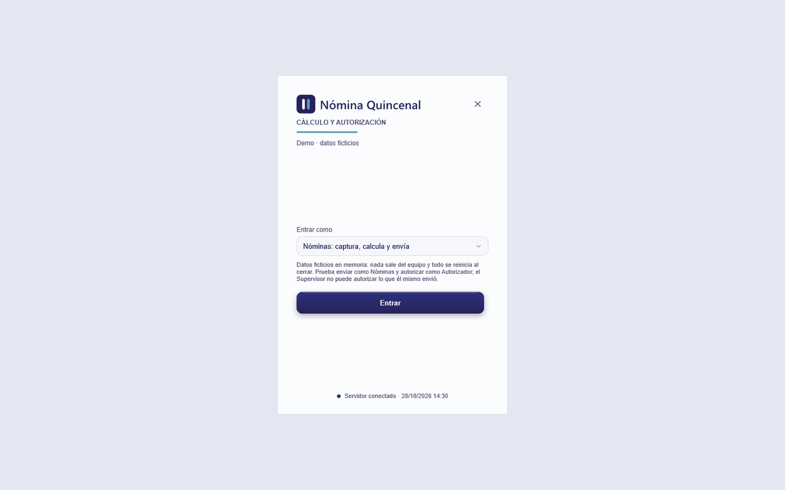
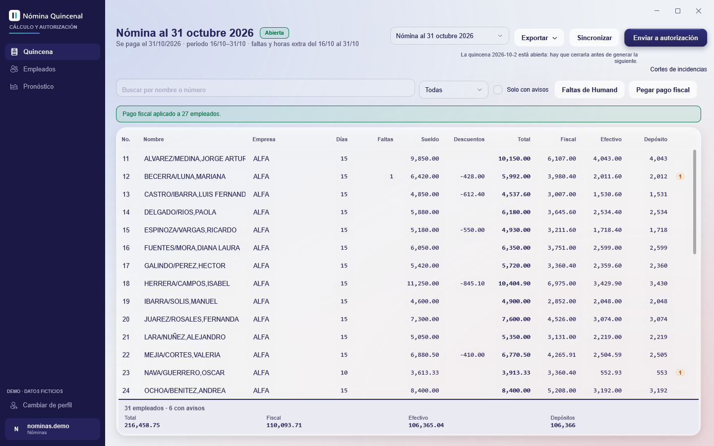
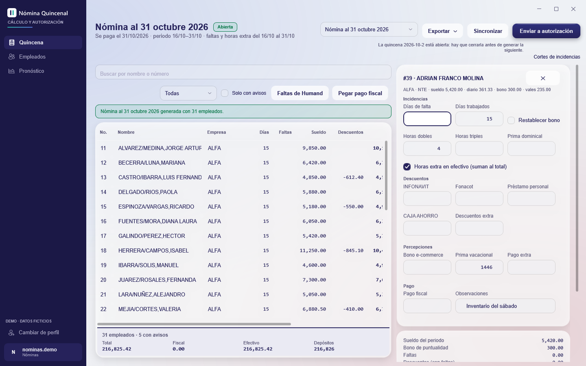
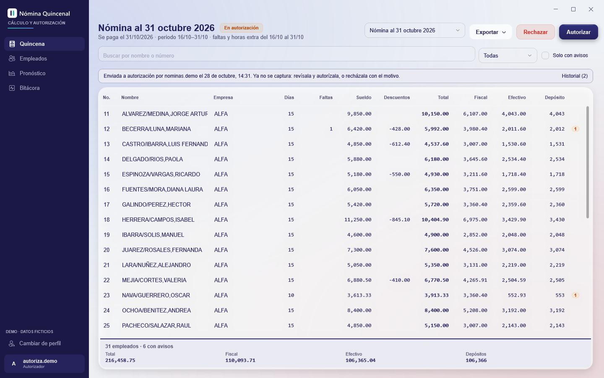
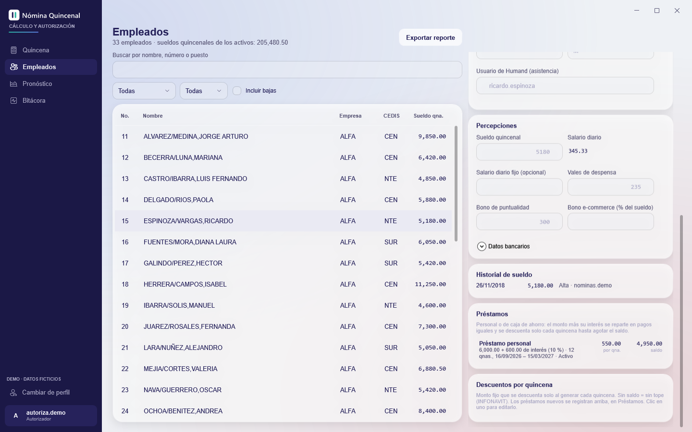
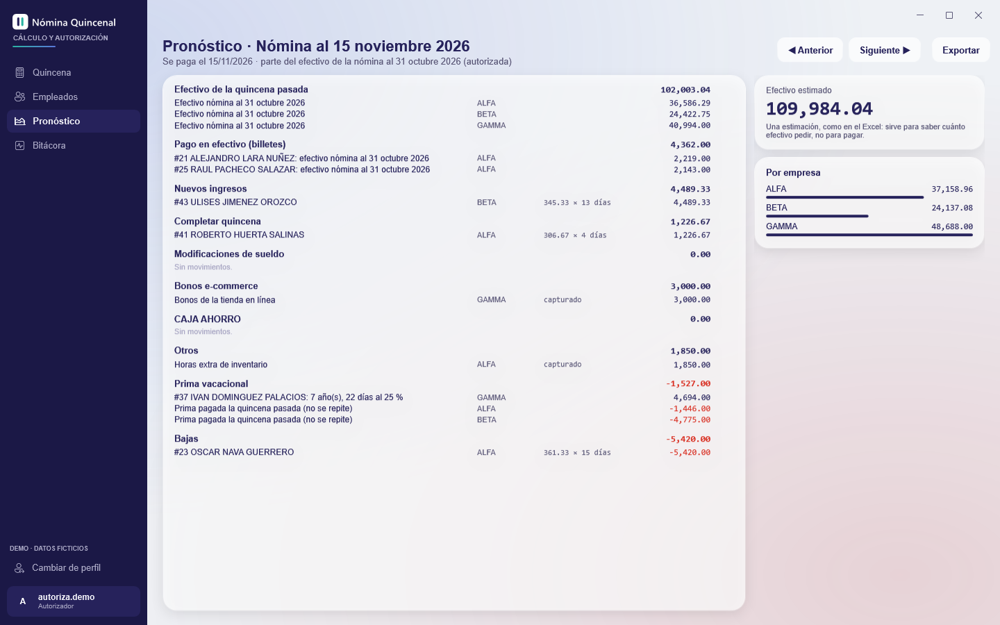
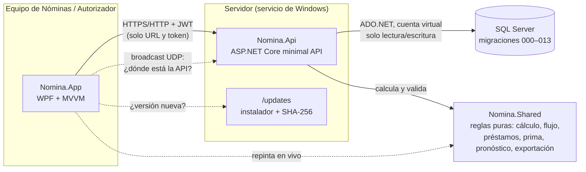

  
  <h1>Nómina Quincenal</h1>
  
<b>App de escritorio para capturar, calcular y autorizar la nómina quincenal de un grupo de varias empresas, con separación de funciones entre quien la arma y quien la aprueba.</b>

  

    
  

  

    
    
    
    
    
    
  

## El problema

La nómina quincenal de ~100 empleados repartidos en cinco razones sociales vivía en un libro de
Excel de once hojas: catálogo, cálculo línea por línea, prima vacacional, préstamos y el
pronóstico de efectivo. Cada quincena se copiaba la hoja anterior, las fórmulas se rompían en
silencio, la prima dependía del día en que se abría el archivo y quien capturaba era también quien
daba el visto bueno. No había rastro de quién cambió qué.

## Qué hace

- **Genera la quincena** con quienes estaban vigentes en el periodo: congela sueldo, bono, vales y
  empresa en cada línea y propone días trabajados para altas y bajas a media quincena.
- **Calcula cada línea en vivo** (faltas, bono de puntualidad, horas extra, descuentos, total,
  efectivo y depósito) con las mismas reglas que el Excel, reproducidas al centavo.
- **Importa las faltas** desde el reporte de asistencia (.xlsx) y **pega el pago fiscal** tal como
  se copia de Excel; nada se aplica sin confirmar.
- **Sugiere la prima vacacional** en la quincena del aniversario, por antigüedad de calendario.
- **Lleva el flujo de autorización**: Nóminas envía, el Autorizador autoriza, rechaza o reabre con
  motivo. Quien envía una quincena no puede autorizarla.
- **Baja los saldos de los préstamos al autorizar** (y los devuelve si se reabre), con planes de
  pago prorrateados por quincena.
- **Pronostica el efectivo** de la siguiente quincena: altas, bajas, cambios de sueldo, primas y
  ajustes manuales, por empresa.
- **Exporta** la quincena, las cuentas de pago, el pronóstico y el reporte de empleados a Excel o CSV.

## Demo

| | | |
|:-:|:-:|:-:|
|  |  |  |
| La quincena con el fiscal pegado | Captura de una línea con prima sugerida | Vista del Autorizador |
|  |  | |
| Ficha con préstamo y saldo | Pronóstico de efectivo por empresa | |

La demo es la app WPF real con la API sustituida por un servidor en memoria: no instala nada, no
usa SQL Server y no sale a la red. Al entrar se elige el perfil:

- **Nóminas**: genera la quincena, captura, pega el fiscal y la envía.
- **Autorizador**: la revisa y la autoriza, o la rechaza con motivo.
- **Supervisor**: tiene los dos permisos y aun así no puede autorizar lo que él mismo envió.

Todos los nombres, sueldos, empresas y números son ficticios.

## Arquitectura

- El cliente nunca conoce la cadena de conexión: solo la URL de la API y el token del login.
- Los permisos viajan como claims en el JWT y **la API revalida cada acción**; la interfaz solo
  oculta o deshabilita botones.
- `Nomina.Shared` no tiene dependencias: el cliente lo usa para recalcular mientras se teclea y la
  API lo usa para calcular lo que de verdad se guarda.

## Decisiones de ingeniería

- **La separación de funciones vive en el servidor, no en los botones.** La regla «quien envía no
  autoriza» es una función pura (`FlujoQuincena.Validar`) que la API aplica dentro de la misma
  transacción que cambia el estado, con la quincena leída con candado. Cuenta quien la envió *la
  última vez*, así que reenviarla tras un rechazo no abre un hueco. Cada acción manda la
  `rowversion` con que se leyó la quincena: si alguien la movió en medio, la API contesta 409 y
  nadie autoriza números distintos de los que tuvo en pantalla. La única excepción (el Admin
  autoriza lo suyo) es un permiso explícito, no un `if` por rol.
- **El servidor calcula; el cliente solo propone.** Total, efectivo, faltas en pesos y horas extra
  salen de `CalculoNomina` en la API. Los DTOs de guardado *no tienen* campos para mandarlos, así
  que no hay forma de que un cliente viejo o manipulado guarde un total inventado. El mismo código
  corre en el cliente para el cálculo en vivo, de modo que lo que se ve es lo que se guarda.
- **Dinero en `decimal`, redondeando solo donde el Excel redondeaba.** Sueldos con cuatro
  decimales (un aumento del 5 % da 8,494.7625) y calculados con seis; el depósito es
  `ROUND(efectivo, 0)` y la prima `ROUNDUP`, nada más. Lo capturado se lleva a la escala de su
  columna *antes* de calcular, para que el total guardado salga de los importes guardados. Los
  préstamos reparten `total ÷ N` redondeado hacia arriba al centavo y la última quincena absorbe la
  diferencia (1,000 en 3 → 333.34 · 333.34 · 333.32): hacia abajo quedaría un centavo para una
  quincena N + 1. **550 pruebas xUnit**; las reglas se derivaron celda por celda y se prueban
  contra filas reales del libro (sin nombres), y las que mueven dinero pasaron además por pruebas
  de mutación: se rompe el código a propósito y se confirma que alguna prueba falla.
- **Los saldos bajan al autorizar, con rastro.** Generar una quincena no toca los préstamos; al
  autorizarla, lo realmente descontado se reparte del préstamo más antiguo al más nuevo y cada
  abono queda en `descuento_abonos`. Reabrir devuelve exactamente lo abonado. Como solo se puede
  reabrir la última quincena, ninguna posterior dependía de esos saldos.
- **Migraciones idempotentes y numeradas.** `000`–`013` se pueden correr dos veces sin efecto (el
  script de base local las corre completas cada vez, y así se verifica). El login técnico solo lee y escribe datos; un script
  aparte comprueba, impersonándolo, que no puede alterar el esquema. Los roles y permisos no van en
  migraciones: los siembra la API desde el catálogo en código.
- **Del Excel a tablas, columna por columna.** Cada columna de la hoja de cálculo tiene destino
  documentado: el «nombre de nómina» y el de lectura, el sueldo (cuando la celda era
  `=Salario diario × N`, se reconstruye el sueldo completo), los créditos a descuentos recurrentes,
  la tabla de vacaciones sembrada tal cual. La línea de la quincena **congela** al empleado: subir un
  sueldo en marzo no recalcula enero. El historial de cada línea se guarda como JSON completo con
  `CHECK ISJSON`, no como treinta columnas duplicadas.
- **Mismo chasis que [Mithril SkyLine](https://github.com/RexGhidorah/mithril-skyline) y
  [Robin DMS](https://github.com/RexGhidorah/robin-dms).** Auth con BCrypt y JWT, permisos por rol
  con excepciones por usuario, bitácora, auto-actualización, tema WPF y `MoneyExpression` (teclear
  `2445+13452.25` en un importe) se heredaron en vez de reescribirse; lo nuevo fue el dominio.
- **Dos instaladores Inno Setup.** El del **servidor** abre un configurador que instala SQL Server
  Express si no hay (bajado de Microsoft con verificación de firma), crea la base, registra la API
  como servicio con *cuenta virtual* (sin contraseñas), abre el firewall, programa un respaldo
  diario cifrado y sabe mover el servidor a otro equipo con un paquete exportado. El del
  **cliente** se instala sin permisos de administrador, encuentra la API en la red por broadcast UDP
  y se actualiza solo desde la propia API, comprobando el SHA-256 del instalador.

## Stack

| Capa | Tecnología |
|---|---|
| Cliente | WPF (.NET 10), CommunityToolkit.Mvvm, tema propio |
| API | ASP.NET Core minimal API, JWT, BCrypt, servicio de Windows |
| Datos | SQL Server (Express / LocalDB), ADO.NET con `Microsoft.Data.SqlClient`, sin ORM |
| Dominio | `Nomina.Shared`: código puro sin dependencias, compartido por cliente y servidor |
| Exportación | Escritor y lector de .xlsx propios (Open XML a mano, sin paquetes) y CSV |
| Pruebas | xUnit: 550 pruebas, más pruebas de humo de punta a punta contra una base desechable |
| Despliegue | Inno Setup (cliente y servidor), feed de actualizaciones servido por la API |

## Correr la demo localmente

1. Descarga `NominaQuincenal-Demo-win-x64.zip` de
   [Releases](https://github.com/RexGhidorah/nomina-quincenal/releases/latest).
2. Descomprime y abre `NominaQuincenal-Demo.exe` (Windows 10/11 x64; no requiere instalar .NET).
3. Elige el perfil y entra. «Cambiar de perfil», abajo a la izquierda, vuelve al login.

El ejecutable no está firmado: si aparece SmartScreen, *Más información → Ejecutar de todas formas*.
Los datos viven en memoria y se reinician al cerrar.

---
🔒 Proyecto real, construido para un grupo empresarial con varias razones sociales. El código de negocio
es privado; este repo contiene la documentación y una demo con datos ficticios.
